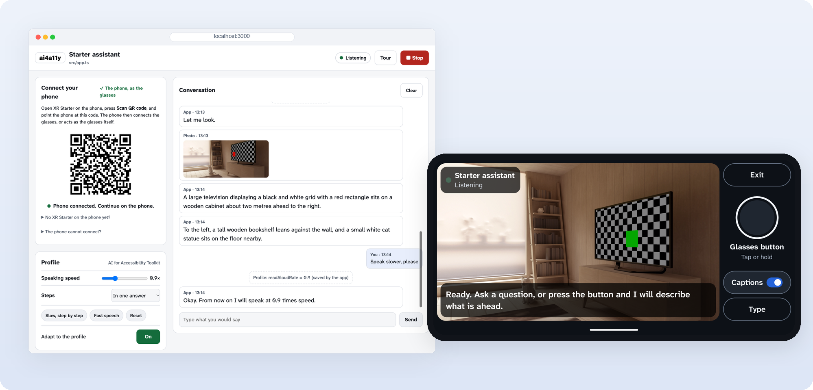
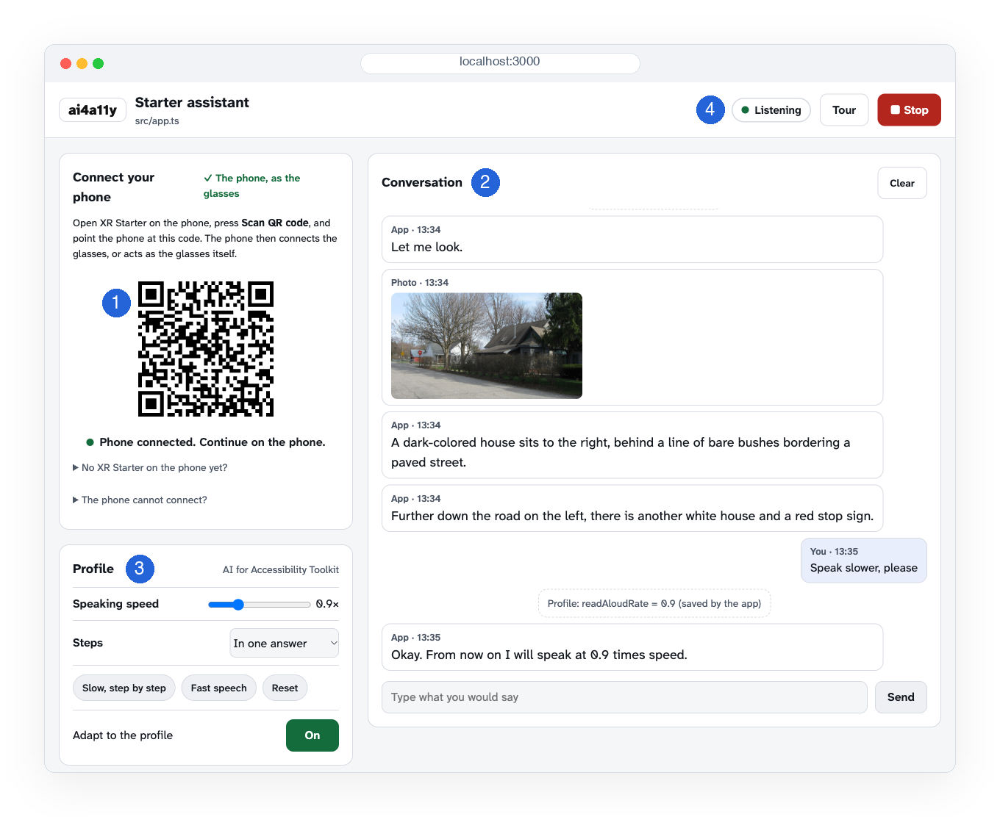
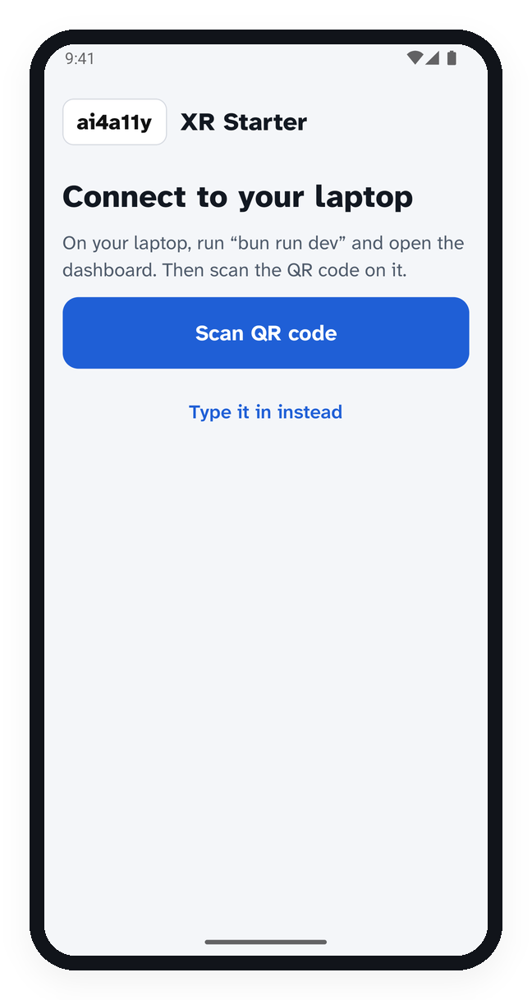
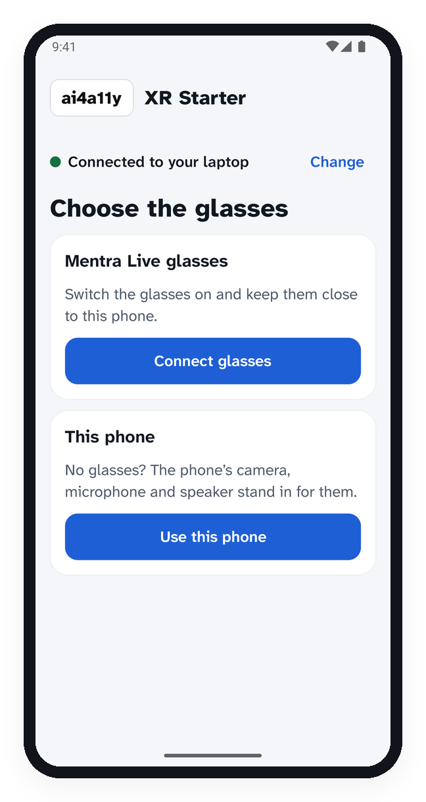
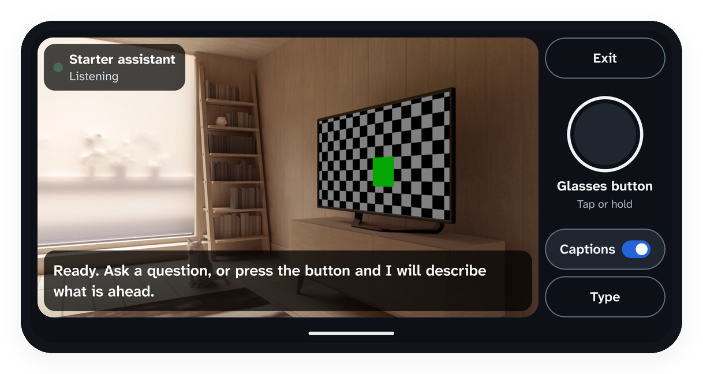

<p align="center">
  
</p>

<h1 align="center">XR Starter</h1>

<p align="center">
  <b>Build a voice app for Mentra Live smart glasses in an afternoon.</b><br>
  The glasses have a camera, a microphone, a speaker and one button. They have no screen,<br>
  so your app listens, looks and talks. You write it in one TypeScript file.
</p>

<p align="center">
  
</p>

The starter handles the glasses, speech, photos and Gemini for you. The
[AI for Accessibility Toolkit](https://github.com/AI-for-Accessibility-Collective/AI-for-Accessibility-Toolkit)
keeps the wearer's profile, such as "speak slower" or "one step at a time",
and the starter adapts your app's speech to it.

## Start in three steps

### 1. Install

You need [Bun](https://bun.sh) and a free Gemini key from
[Google AI Studio](https://aistudio.google.com/apikey).

```bash
curl -fsSL https://bun.sh/install | bash
git clone https://github.com/AI-for-Accessibility-Collective/AI-for-Accessibility-XR-Starter.git
cd AI-for-Accessibility-XR-Starter
bun install
cp .env.example .env    # paste your key after GEMINI_API_KEY=
bun run check           # ends with "Ready"
```

<sub>On Windows, install Bun with <code>powershell -c "irm bun.sh/install.ps1 | iex"</code>.</sub>

### 2. Run

```bash
bun run dev
```

Open **http://localhost:3000**. This is your dashboard.



1. **QR code.** The phone scans it to connect.
2. **Conversation.** What the app hears, says and sees. You can type here instead of talking.
3. **Profile.** What the wearer needs. Try a slower speed.
4. **Start and Stop**, and what the app is doing now.

### 3. Connect a phone

No glasses yet? A phone stands in for them, with its camera, microphone and
speaker, and a round button on the screen.

**Get the app:** bring the phone and its cable to the organiser, who installs
it over the cable in a few minutes. On Android, turn on USB debugging under
Developer options first. On an iPhone, tap **Trust** when the phone asks.
Android phones can also install it from a link: open
[XR-Starter.apk](https://github.com/AI-for-Accessibility-Collective/AI-for-Accessibility-XR-Starter/releases/latest/download/XR-Starter.apk)
on the phone and allow the install.

<table>
  <tr>
    <td align="center" width="25%"></td>
    <td align="center" width="25%"></td>
    <td align="center" width="50%"></td>
  </tr>
  <tr>
    <td align="center"><b>1.</b> Press <b>Scan QR code</b> and point the phone at the dashboard.</td>
    <td align="center"><b>2.</b> Press <b>Use this phone</b>.</td>
    <td align="center"><b>3.</b> Hold it sideways at eye level. Talk, or tap the round button.</td>
  </tr>
</table>

Then try it: ask a question, say **"what do you see?"**, tap the button, or
say **"speak slower"**.

<details>
<summary><b>With the real glasses</b></summary>
<br>

The organiser has the glasses and a phone with XR Starter. On that phone,
scan your dashboard's QR code, press **Connect glasses**, then **Start**.
The glasses button is on the right arm.

When you are done, press **Stop** and pass the glasses on. The next team
opens **More options › Connect to another laptop** on the phone and scans
their own QR code.

</details>

## Make it yours

Open `src/app.ts` and change it. When you save, the app restarts and the
phone reconnects by itself. Here is a whole app that reads text aloud:

```ts
import { defineApp } from './starter/index.ts';

export default defineApp({
  name: 'Read it to me',
  instructions: 'You read printed text aloud, word for word.',

  async onStart(g) {
    await g.say('Ready. Press the button and I will read the text ahead.');
  },

  async onButton(button, g) {
    if (button.press === 'long') return g.stopSpeaking();
    await g.say('Let me look.');
    const photo = await g.takePhoto({ mode: 'text' });
    await g.say(await g.ai.ask('Read the text in this photo.', { photo }));
  },

  async onSpeech(text, g) {
    await g.say(await g.ai.chat(text));
  },
});
```

| To | Write |
|---|---|
| Speak | `await g.say('Hello')` |
| Hear the person | `onSpeech(text, g) { ... }` |
| Wait for the next answer | `const answer = await g.listen()` |
| Take a photo | `const photo = await g.takePhoto()` |
| See the view every second | `camera: 'live'` and `onFrame(frame, g) { ... }` (glasses on Wi-Fi) |
| Ask Gemini | `await g.ai.ask('What is this?', { photo })` |
| Chat, with memory | `await g.ai.chat(text)` |
| Use the button | `onButton(button, g) { ... }`, where `button.press` is `'short'` or `'long'` |
| Read the profile | `g.profile.settings.rate`, `g.profile.get('captions')` |
| Light the glasses' LED | `g.light('green')` |
| Write to the dashboard log | `g.log('found the door')` |

The full API is in [`src/starter/index.ts`](src/starter/index.ts).

### Start from an example

```bash
bun run dev examples/2-what-do-you-see.ts
```

| Example | What it does |
|---|---|
| [`1-echo.ts`](examples/1-echo.ts) | Says back what it heard. The smallest app. |
| [`2-what-do-you-see.ts`](examples/2-what-do-you-see.ts) | Describes what is ahead, then answers questions about it. |
| [`3-read-it-to-me.ts`](examples/3-read-it-to-me.ts) | Reads a letter, a label or a menu aloud. |
| [`4-step-by-step.ts`](examples/4-step-by-step.ts) | Guides a task one step at a time, and follows the profile. |
| [`5-remember-for-me.ts`](examples/5-remember-for-me.ts) | Remembers where you put things, and tells you later. |
| [`6-watch-ahead.ts`](examples/6-watch-ahead.ts) | Watches the way ahead on the live camera, and says when the view changes. |

To build on one, copy it over your app (`cp examples/3-read-it-to-me.ts src/app.ts`)
and change its import to `'./starter/index.ts'`.

### Tips for an app people hear

- Use short sentences, one idea each.
- When a step takes time, say so at once: "Let me look."
- Tell the wearer what they can say next.
- Say where things are from the wearer: left, right, ahead, two metres.
- Try it early with the people on your team who will use it.

## The accessibility profile

The toolkit keeps a profile of what the wearer needs. `g.say` follows its
speaking speed and pacing. `g.ai` adds its wording needs to each request:
plain words, the level of detail, and describing surroundings. Switch
**Adapt to the profile** off and on in the dashboard to hear the difference.

Your app can read the profile with `g.profile` and change what it does.
Save a change when the person asks for one, as "speak slower" does. To add a
need of your own, add it to `src/toolkit/needs.ts`.

## Use a coding agent

[`AGENTS.md`](AGENTS.md) explains this repo to Claude Code, Codex or Cursor.
A good first message:

> Read AGENTS.md. Then change src/app.ts so that ... Run `bun test` and `bun run typecheck` when you are done.

## Help

<details>
<summary><b>Troubleshooting</b></summary>
<br>

| Problem | What to do |
|---|---|
| `bun run check` says the key is missing | Put `GEMINI_API_KEY=...` in `.env`. Copy `.env.example` to `.env` first. |
| The phone says "Cannot reach your laptop" | Check that `bun run dev` is running and the phone is on the same Wi-Fi. If both are fine, the Wi-Fi may keep devices apart: run a tunnel (below). |
| The phone asks you to scan again | The laptop has a new pairing code. Press **Scan QR code** and scan the dashboard again. |
| The phone does not hear you | Allow the microphone for XR Starter in the phone's Settings. The phone stops listening while the app speaks. |
| The app ignores what you said | The dashboard shows "not handled" and the reason. Usually the app was still busy. |
| No sound in the glasses | iPhone: choose the glasses in Settings › Bluetooth. Android: in Bluetooth settings, tap the glasses and turn on Media audio. |
| Answers feel slow | Gemini's voice takes 2 to 5 seconds per sentence. Put `VOICE=device` in `.env` for the phone's own voice, which starts at once. |
| "Gemini is switched off" | A spending guard stopped Gemini after 60 calls in a minute or 800 in a run. Restart `bun run dev`. |
| Port 3000 is in use | Another copy is running. Stop it, or put `PORT=3001` in `.env`. |

**Run a tunnel** when the phone cannot reach your laptop over the Wi-Fi:

```bash
brew install cloudflared    # once. Windows: winget install --id Cloudflare.cloudflared
bun run tunnel              # in a second terminal, then scan the new QR code
```

</details>

<details>
<summary><b>What is in the repo</b></summary>
<br>

```
src/app.ts          your app (start here)
examples/           six small apps to run or copy
src/toolkit/        the profile: what it means for speech and for the AI
src/starter/        the engine: glasses link, speech, voice, AI, dashboard
phone/              the XR Starter phone app (phone/README.md)
vendor/             a copy of the toolkit package (do not edit)
docs/ORGANIZER.md   preparing the glasses and phones for the event
```

</details>

<details>
<summary><b>Costs, privacy and limits</b></summary>
<br>

- Each thing the wearer says costs one or two Gemini calls, and each answer
  one or two more. The limits in `.env` cap the cost.
- Photos stay in memory on your laptop, and go to Gemini when your app asks
  about them. The dashboard opens on your laptop and refuses other devices.
- The glasses show a light while they take a photo. Tell people nearby when
  you take photos.
- The starter takes single photos. It does not stream video.

</details>

## Contact

For a bug or a question about this repository, open an [issue](../../issues)
here. For anything else, use the Collective's
[contact form](https://forms.gle/pTH6nSKMXmqbx9Eg8) or email
ai4a11y-collective-contact@googlegroups.com. The other routes, including
those for security problems and code of conduct reports, are in the toolkit's
[MAINTAINERS.md](https://github.com/AI-for-Accessibility-Collective/AI-for-Accessibility-Toolkit/blob/main/MAINTAINERS.md).
For more about the project, see the Collective's website,
[aiforaccessibilitycollective.org](https://aiforaccessibilitycollective.org).

<br>

<p align="center"><sub>
Apache 2.0, like the toolkit. Based on the
<a href="https://github.com/AI-for-Accessibility-Collective/AI-for-Accessibility-XR">AI for Accessibility XR</a>
project. Organisers: see <a href="docs/ORGANIZER.md">docs/ORGANIZER.md</a>.
</sub></p>
